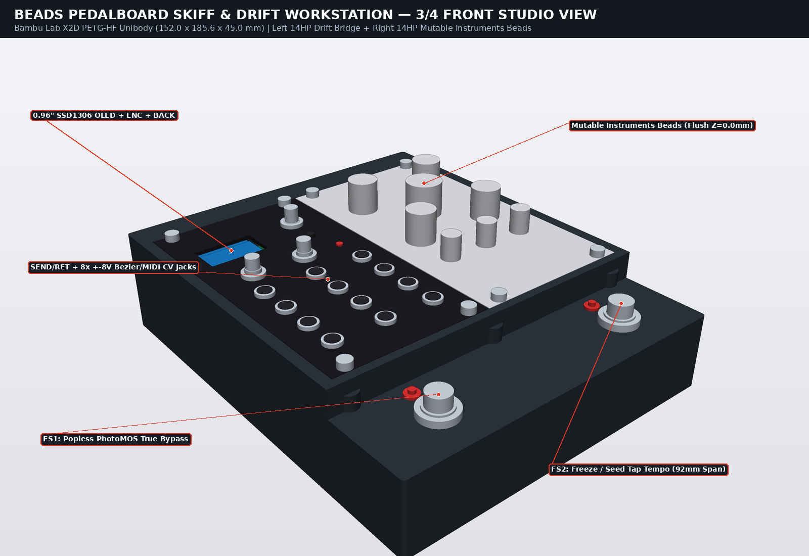
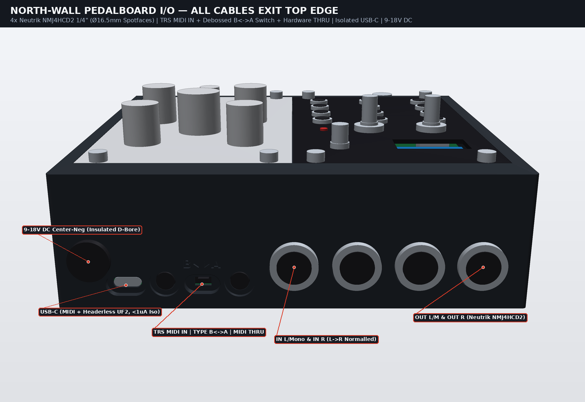
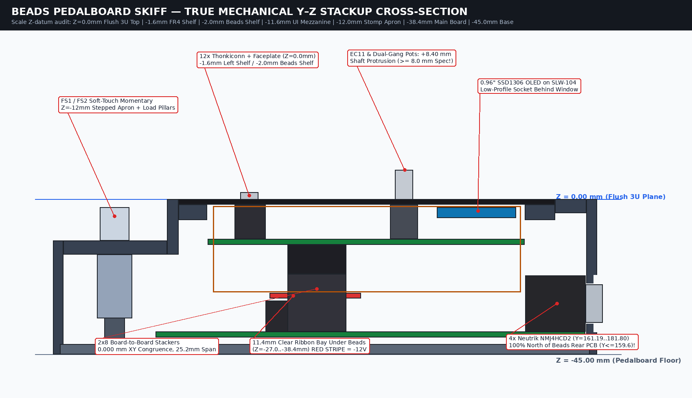
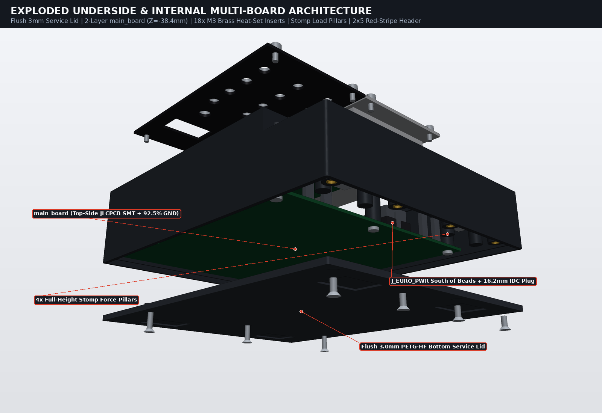
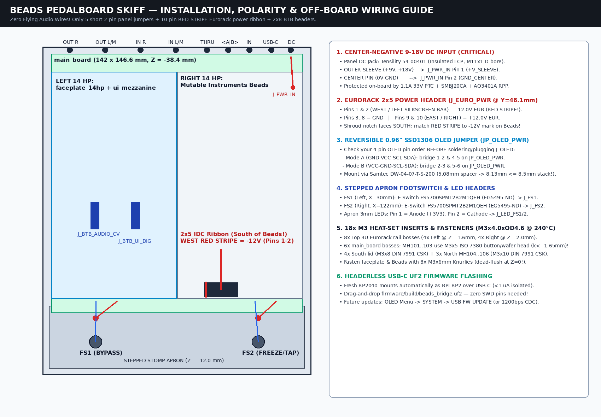

# Mutable Instruments Beads Pedalboard Skiff, Stereo Audio/MIDI-to-CV Bridge & Autonomous Drift Workstation



A complete, fabrication-ready **low-profile guitar pedalboard skiff (`152.0 × 185.6 × 45.0 mm`, Bambu Lab X2D `PETG-HF`)** that houses an unmodified **Mutable Instruments Beads (`14 HP × 3U`)** Eurorack granular synthesizer directly on a standard **`9V–18V DC` center-negative guitar pedalboard**, pairing it with a **popless PhotoMOS + Omron relay stereo `1/4"` guitar interface**, **hardware `MIDI THRU` + `USB-C` MIDI**, and an **8-channel `-8.2V..+8.2V` `RP2040` Cubic Bezier "Drift" & calibrated `1V/Oct` CV workstation**.

---

## Visual Architecture & Mechanical Views

| North-Wall Pedalboard I/O | True Mechanical Y–Z Cross-Section |
|---|---|
|  |  |

| Exploded Multi-Board Architecture | Off-Board Wiring & Polarity Checklist |
|---|---|
|  |  |

---

## Key Engineering Highlights

1. **Multi-Stage Protected `9V–18V DC` Center-Negative → Ultra-Quiet `±12.0V` Eurorack Power (`plan/01`):**
   - Standard **`2.1 × 5.5 mm` Center-Negative** input (`Outer Sleeve = +9..18V`, `Center Pin = 0V GND`) via an all-insulated LCP panel DC jack (**Tensility `54-00401`**) into a **`33V 1.1A` resettable PTC (`SMD1812B110TF/33`, `C269134`)**, **`600W` bidirectional TVS (`SMBJ20CA`, `C19077576`)**, **`AO3401A` reverse-polarity P-MOSFET** with **`18V`-safe `9.1V` Zener gate clamp (`BZX84-C9V1`)**, and input LC Pi-filter (`BLM18PG121SN1D` `2A` ferrite).
   - **`TPS5430DDAR` (`+5.08V @ 500 kHz`)** → **`TPS65131RGER` (`+14.65V / -14.56V @ 1.38 MHz` fixed-PWM, `PSP/PSN=GND`)** → linear **`LM317AG-TN3-R` (`+12.0V_EUR`)** & ESR-damped **`79M12(TP)` (`-12.0V_EUR`)** post-regulators + `2A` ferrite LC filters feeding the shrouded **`2×5` Eurorack IDC box header (`J_EURO_PWR`)** marked **`RED STRIPE / -12V (PINS 1-2)`**.
   - **`< 1 µA` Bidirectional `USB-C VBUS` ↔ `+5V_BUCK` Isolation & `3.3V → 5V` Level Shifting:** `D_OR_PED` (`1N5819WS`) + `PIN_VBUS_DET`-gated `RP2040` `1.5 kΩ` D+ pull-up (preventing `SRV05-4` back-feed into powered-off hosts) + `I_off`-isolated **`SN74AHCT541PWR`** (`C50989`) SPI/CS level shifter with `+5V_BUCK` pull-ups (`R77..R80`), ensuring `MCP4822` `V_IH >= 3.56V` compliance and `< 0.5 µA` zero-backfeed isolation during simultaneous `USB-C` + pedal DC or USB-only UF2 bench flashing.

2. **Stereo `1/4"` Guitar ↔ Eurorack Gain Staging & Boutique Popless PhotoMOS True Bypass (`plan/02`):**
   - `4×` North-edge PCB-mounted **Neutrik `NMJ4HCD2`** `1/4"` jacks (`OUT R`, `OUT L/Mono`, `IN R` passively normalled from `IN L/Mono` via `TN`; output `TN` pins strictly isolated — **zero flying audio wires!**).
   - **`1 MΩ` `TL072CDT` JFET Stereo Guitar Preamp** (`+18.0 dB` at `12 o'clock` on dual-gang `IN TRIM` → `SEND L / SEND R` Thonkiconn) paired with **`100 kΩ` `NE5532DR` + `TL072CDT` Stereo Return** (`-18.0 dB` at `12 o'clock` on dual-gang `OUT TRIM` ← `RET L / RET R` Thonkiconn) = **`0.0 dB` end-to-end unity gain and `0°` non-inverting phase**.
   - **Clickless / Popless Relay True Bypass (`15.0 ms` Window + `250 ms` POR Blanking):** Combines `2× Omron G6K-2F-Y-TR DC5` gold-clad DPDT relays (`fail-safe passive copper bypass when unpowered`) with **`2× Toshiba TLP172AM` (`SOP-4`, `3.75 kV` optical isolation, `0 pC` charge injection) PhotoMOS shunt mutes** (`47.3 dB` mute attenuation, `< 1.6 mV` bounce transient), `8× 2.2 MΩ` zero-DC bleed resistors, soft-slewed coil/LED drive, and **EQD Flexi-Switch auto-momentary** (`short tap < 350 ms` toggles; `hold >= 350 ms` momentarily engages Beads while held).
   - **Overvoltage-Proof Guitar Peak & Pluck Detector:** `+3.30V`-powered **`MCP6002T-I/SN`** + `BAV99` clamp (`<= 2.79V` even under `12 Vpk` fault surges) feeding `RP2040 ADC0`.

3. **8× Universal `-8.2V..+8.2V` Bipolar CV / Calibrated `1V/Oct` / Gate Outputs + Hardware `MIDI THRU` (`plan/02`, `plan/05`):**
   - `4× MCP4822-E/SN` (`12-bit` Dual SPI DACs, internal `2.048V` ref, `0xFFFF` delta-gated SPI) + `CJ431`/`OP07CDR` `+2.495V` precision offset reference + `4× TL072CDT` bipolar drivers + `1 kΩ` protection resistors → `8×` `WQP-PJ398SM` Thonkiconn jacks (`CV 1..CV 8`).
   - Top-mounted `3.5 mm` TRS `MIDI IN` with right-angle **C&K `JS202011AQN` `MIDI TYPE A / B`** crossover switch → **`H11L1M` (`DIP-6`)** optocoupler → **`74HC14D` zero-latency hardware `MIDI THRU`** (`3.5 mm` TRS Type A) + `RP2040 UART0_RX` merged seamlessly with **`USB-C` MIDI**.
   - Per-channel **Autonomous `C¹` Cubic Bezier Random Drift**, free/clock-synced **256-pt LFOs** (`Sine`, `Tri`, `Ramp Up/Down` for `TIME` scrubbing, `Square`, `Slewed S&H`), **Euclidean `(Steps, Hits)` Triggers**, **9-Octave LUT-Calibrated `1V/Oct` Pitch CV**, **MIDI Gate/Trig/Clock-Div/CC**, **Guitar Envelope/Pluck**, and **FS2 `FREEZE` / `SEED` Tap-Tempo** — viewed on a **`0.96"` `128×64` `SSD1306` OLED oscilloscope** and stored in **dual-slot A/B `CRC32` + `write_seq` QSPI Flash (`32` presets)**.

4. **Cost-Optimized 3-Board 2-Layer JLCPCB Partitioning & Bambu Lab X2D `PETG-HF` Stepped Enclosure (`plan/03`, `plan/04`):**
   - **`main_board` (`142.0 × 146.6 mm`, 2-layer `1.6 mm` FR4):** Single-sided Top-Side JLCPCB SMT PCBA (`77` unique verified LCSC parts: **`54` Basic, `7` Preferred, `16` Extended**, `304` SMD placements, `0` THT in CPL, **`92.49%` single largest connected `B.Cu` ground island** with `0` un-stitched islands, `0.80 × 1.60 mm` `SJ1-3523N` plated slots, `0.500 mm` min NPTH edge web + `0.70 mm` `SJ1-3523N` collar relief notches, `202` nets, `ERC = 0/0`, `DRC = 0` errors / `0` warnings, `unconnected = 0`).
   - **`ui_mezzanine` (`68.0 × 108.0 mm`, 2-layer `1.6 mm` FR4, `$0` PCBA fee):** Pure user-hand-soldered THT carrier (`12×` Thonkiconn, `SSD1306` w/ reversible `JP_OLED_PWR` & `8.13 mm <= 8.50 mm` low-profile `DW-04-07-T-S-200` stack, `EC11E15244G1` 15 PPR bushingless, `BACK`, `2×` vertical dual-gang `10 kΩ` trim pots `Alpha RD902F-40-15R1-B10K-00D`, `PEAK` LED, `B.Cu`-mounted `0.0000 mm` XY-matched `2×8` BTB sockets, `21/21` local `${KIPRJMOD}` 3D STEP links).
   - **`faceplate_14hp` (`70.80 × 128.50 mm`, 2-layer `1.6 mm` Matte-Black FR4, `$0` PCBA fee):** Sits on the `-1.60 mm` Left 3U rail shelf alongside Mutable Instruments Beads on the `-2.00 mm` Right 3U rail shelf — **both panels dead-flush at `Z = 0.00 mm`** above a `-12.00 mm` stepped front stomp apron (`92.0 mm` footswitch spacing) reinforced by `4×` full-height internal stomp pillars and `18×` `M3` brass heat-set inserts (**`0.000 mm³` pairwise `OCP BRepAlgoAPI_Common` collision across all `417` un-grouped solids + `0.000 mm³` `15`-pose × `321`-part rigid-body insertion sweep**).

---

## Repository Structure

```text
├── PLAN.md                           # Master specification index
├── README.md                         # Project overview, flashing & verification guide
├── hardware_contract.json            # Single-source-of-truth spatial, PCB & GPIO contract
├── plan/                             # Authoritative 00..05 engineering specifications
├── hardware/
│   ├── main_board/                   # KiCad 9 2-layer Main Floor PCB + hierarchical schematics
│   ├── ui_mezzanine/                 # KiCad 9 2-layer 14HP THT Mezzanine PCB
│   ├── faceplate_14hp/               # KiCad 9 14HP Matte-Black FR4 Eurorack Panel
│   ├── beads_custom.kicad_sym        # Project-local ERC-typed custom schematic symbols
│   ├── beads_custom.pretty/          # Project-local custom footprints (${KIPRJMOD}-portable)
│   ├── beads_custom.3dshapes/        # Local parametric 3D STEP component models
│   └── spice/verify_analog.py        # Netlist-derived 7-gate ngspice verification suite
├── manufacturing/
│   ├── main_board/                   # Gerbers, Drills, Schematic PDF, JLCPCB SMT BOM & CPL
│   ├── ui_mezzanine/                 # Gerbers, Drills, Schematic PDF & THT BOM
│   ├── faceplate_14hp/               # Gerbers, Drills & Schematic PDF (Matte Black FR4)
│   └── HAND_SOLDER_AND_BOM.md        # Complete JLCPCB order settings, DigiKey/Thonk BOM & build guide
├── firmware/
│   ├── Makefile & CMakeLists.txt     # Bare-metal ARM UF2 build + Pico SDK CMake + Host unit tests
│   ├── include/ & src/               # Dual-core RP2040 C11 engine, Bezier/LFO/1V-Oct, OLED, Presets
│   ├── target/                       # RP2040 XIP boot2, linker script & silicon register HAL
│   ├── tests/test_beads_firmware.c   # 11 deterministic host silicon-mock assert() test suites
│   └── build/beads_bridge.uf2        # Ready-to-flash RP2040 UF2 firmware image (0xE48BFF56)
├── cad/
│   ├── build_enclosure.py            # Parametric Build123d enclosure, 417-solid assembly & studio renderer
│   ├── verify_3d_collisions.py       # 417-solid pairwise + 321-part kinematic OCP BRepAlgoAPI_Common 0.000 mm³ gate
│   └── exports/                      # Print-ready STLs, STEPs, Studio PNGs & Wiring Diagram
└── scripts/
    ├── generate_3d_shapes.py         # Deterministic STEP builder for hardware/beads_custom.3dshapes
    ├── layout_boards.py              # Deterministic KiCad 9 board placement & outline generator
    ├── route_boards.py               # Specctra DSN + bounded Freerouting + fresh-process zone filler
    ├── verify_pcb_gates.py           # Gate 1 KiCad 9 ERC/DRC/Pour/BTB/Paste/Keepout verifier
    ├── export_manufacturing.py       # Gate 2 Gerber/BOM/CPL exporter & jlcpcb_parts.db verifier
    └── run_all_checks.sh             # Master 5-gate end-to-end verification suite
```

---

## Headerless USB-C UF2 Firmware Flashing (`Zero SWD Pins Required`)

1. **First-Time Factory Bring-Up:**
   - Plug a `USB-C` cable from your computer into the North-wall `USB-C` port (with or without `9–18V` pedal power connected — `< 1 µA` isolated!).
   - A fresh `RP2040` automatically enumerates as **`RPI-RP2`** USB Mass Storage. Copy `firmware/build/beads_bridge.uf2` directly onto the `RPI-RP2` drive.
2. **In-Case Field Updates (No Disassembly Needed):**
   - **Via Front-Panel OLED:** Press `BACK` from the Scope view to enter **`SYSTEM MENU`**, scroll to **`USB FW UPDATE`**, and click the encoder — the skiff reboots immediately into `RPI-RP2` UF2 mode.
   - **Via `1200-baud` USB-CDC Touch:** Run `picotool load -f firmware/build/beads_bridge.uf2` (or open/close the virtual serial port at `1200 bps`).
   - **Hardware Fallback:** Hold onboard SMD **`BOOTSEL` (`SW_BOOT`)** while plugging in `USB-C`.

---

## Bambu Lab X2D `PETG-HF` 3D Printing Guide

- **Print Files:** `cad/exports/beads_enclosure_shell.stl` (`152.0 × 185.6 × 45.0 mm`) and `cad/exports/beads_bottom_lid.stl` (`147.1 × 180.7 × 5.0 mm`).
- **Recommended Bambu Studio Settings (`Bambu Lab X2D`):**
  - **Nozzle 1 (Structural Body):** **Bambu `PETG-HF`** (Charcoal / Black), `0.4 mm` hardened steel nozzle, `0.20 mm` layer height, **`4` wall loops**, `5` top / `5` bottom shell layers, **`25%` Gyroid infill**.
  - **Nozzle 2 (Dedicated Support Interface):** **`Support for PLA/PETG`** (or soluble breakaway interface), `0 mm` top Z-distance, `2` interface layers under the 3U Eurorack rail lips and stepped front stomp apron ceiling for glass-flat overhang surfaces.
  - **Orientation:** Place `beads_enclosure_shell.stl` **flat upright (`Z = -45.0 mm` outer skirt on textured PEI plate)** and `beads_bottom_lid.stl` **outer bottom face (`Z = -45.0 mm`) down on textured PEI plate**.
- Full hand-soldering, `18× M3` heat-set insert installation, `JP_OLED_PWR` jumper selection, and step-by-step wiring instructions are in **[`manufacturing/HAND_SOLDER_AND_BOM.md`](manufacturing/HAND_SOLDER_AND_BOM.md)**.

---

## Reproducing All 5 Verification Gates End-to-End

```bash
bash scripts/run_all_checks.sh
```

`scripts/run_all_checks.sh` executes all 5 mandatory engineering gates from scratch and exits `0`:
1. **Gate 1 (`scripts/verify_pcb_gates.py`):** KiCad 9 `ERC = 0/0`, `DRC = 0` errors / `0` warnings, `unconnected = 0` across all 3 boards, `${KIPRJMOD}` portability + `21/21` `ui_mezzanine` & `SW_MIDI_AB` local STEPs, `92.49%` single largest connected `B.Cu` GND island (`>= 88%`, `0` un-stitched islands), `>= 0.50 mm` bulk power trunks, `0.500 mm` (`>= 0.35 mm`) min NPTH edge web, `0.600 mm` (`>= 0.50 mm`, `L >= 2*W`) min plated-slot DFM across PCB & `PTH.drl` (`0.80 × 1.60 mm` `SJ1-3523N` slots), `F.Cu↔B.Cu` `0.0000 mm` `J_BTB_*` XY congruence, segmented `F.Paste` (`0` via-in-paste), `3.32 mm` `MH*` non-GND keepout, and full-sheet `A2`/`A4` schematic bounds + synced `.net` netlists.
2. **Gate 2 (`scripts/export_manufacturing.py`):** Exports Gerbers, PTH/NPTH drills, schematic PDFs, BOMs, and EasyEDA Pin-1/centroid-verified CPL (`100%` matched against `jlcpcb_parts.db`, `0` zero-stock, `0` THT in CPL).
3. **Gate 3 (`hardware/spice/verify_analog.py`):** Netlist-derived `ngspice` batch verification of `9–18V` RPP + `9.1V` gate clamp, `< 1 µA` bidirectional USB isolation including `U_USB_ESD` (`SRV05-4`) + `R23` + `VBUS_DET`-gated `1.5 kΩ` D+ pull-up + `50 µs` hot-unplug latch-break probe + USB-only `+3V3_DIG`/ESD hot-plug latch test, `> 45 dB` `TLP172AM` popless mute (`< 2 mV` bounce spike), `0.0 dB` `12-o'clock` stereo unity & `0°` phase, `±8.16V` CV span (`CJ431` `R143` stabilized), and `<= 3.30V` `MCP6002` mono/stereo ADC clamp.
4. **Gate 4 (`firmware/Makefile`):** `arm-none-eabi-gcc -Wall -Wextra -Werror -fstack-usage` producing `firmware/build/beads_bridge.uf2` (`0xE48BFF56`, `16 MB` `W25Q128JVSIQ` flash target), `0` 64-bit/float/soft-div helpers in Core 0 RT, `160 B` max stack frame, `EP_CTRL_INTERRUPT_PER_BUFFER` + `PIN_VBUS_DET` dynamic `PULLUP_EN`/`VBUS_DETECT` gating + `WC` `SUSPENDED` clear on `DEV_SOF` + `SUSPENDED` hot-unplug probe + `BUFF_STATUS`-before-`SETUP_REC` verified in ELF & both HALs, and `11/11` host silicon-mock `assert()` test suites (including multi-packet 146 B USB EP0 descriptors, `VBUS_DET` latch-break probe, Core 1 TOCTOU Flash lockout guards, MIDI PC channel sync & `EC11E` 2-edge quadrature).
5. **Gate 5 (`cad/verify_3d_collisions.py`):** `Build123d` + `OCP BRepAlgoAPI_Common` **`0.000000 mm³` pairwise intersection** across all `417` un-grouped solids (`86,736` pairs, including all `296` SMD bodies & `ISO 7380-1` `k=1.65 mm` `MH101..103` bolts), **`0.000000 mm³` rigid-body `main_board` insertion sweep** (`15` poses × `321` soldered parts at `+0.35°` South-down pitch), `1.00 mm` `SW_MIDI_AB` alcove rim + debossed North-wall `B ◄ ► A`, `0.35 mm` (`<= 0.50 mm`) `J_USB` reach (`2.69 mm` North-wall web), `8.13 mm` (`<= 8.50 mm`) `SSD1306` stack, and `+8.40 mm` / `+13.40 mm` (`>= 8.00 mm`) shaft protrusions.
