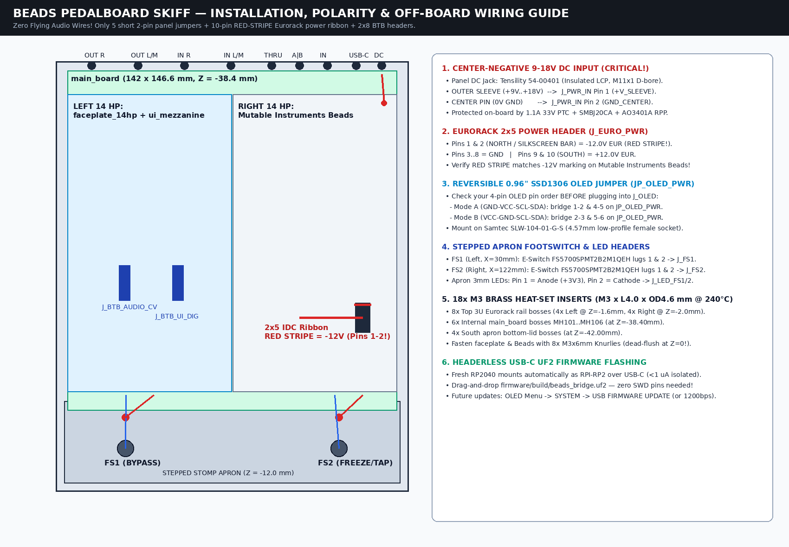

# JLCPCB Ordering, User Hand-Solder Shopping List & Step-by-Step Assembly Guide (`HAND_SOLDER_AND_BOM.md`)

---

## 1. JLCPCB 3-Board Ordering Instructions (Cost-Optimized 2-Layer FR4)

All fabrication outputs are pre-generated and verified in `manufacturing/`:

| Board | Gerber ZIP | Layers / Thickness | Solder Mask / Silkscreen | Surface Finish | JLCPCB PCBA? | Files for PCBA |
|---|---|---|---|---|---|---|
| **`main_board`** (`142.0 × 146.6 mm`) | `manufacturing/main_board/main_board_gerbers.zip` | **2 Layers**, `1.6 mm` FR4, `1 oz` Cu | Green (or Matte Black) + White | HASL (Lead-Free) or ENIG | **YES — Top Side ONLY** (`Single-Sided SMT`) | `main_board_bom.csv` + `main_board_cpl.csv` (`77` unique LCSC parts: `55` Basic, `7` Preferred, `15` Extended; `303` SMD placements; `0` THT) |
| **`ui_mezzanine`** (`68.0 × 108.0 mm`) | `manufacturing/ui_mezzanine/ui_mezzanine_gerbers.zip` | **2 Layers**, `1.6 mm` FR4, `1 oz` Cu | Green + White | HASL (Lead-Free) | **NO (`$0` Bare PCB)** | User hand-solders pure THT parts (`ui_mezzanine_tht_bom.csv`) |
| **`faceplate_14hp`** (`70.80 × 128.50 mm`) | `manufacturing/faceplate_14hp/faceplate_14hp_gerbers.zip` | **2 Layers**, `1.6 mm` FR4, `1 oz` Cu | **Matte Black** + Crisp White *(Select `"Remove Order Number"` / `"Specify Location"` on back)* | **ENIG (Gold)** | **NO (`$0` Bare Panel)** | Pure mechanical 14 HP Eurorack front panel with milled `26.0 × 15.0 mm` OLED window |

---

## 2. Complete User Hand-Soldered Through-Hole & Mechanical BOM (DigiKey / Thonk)

Every off-the-shelf part below is **Active**, in production stock, and dimensionally verified in `cad/verify_3d_collisions.py` (`0.000 mm³` B-Rep interference across all `112` solids):

| Board / Location | Designators | Qty | Component Description | Verified Manufacturer & MPN | Primary Supplier / SKU | Critical Notes |
|---|---|---:|---|---|---|---|
| `main_board` (North Edge) | `J_OUT_R, J_OUT_L, J_IN_R, J_IN_L` | **4** | `1/4"` (`6.35 mm`) Switched Horizontal PCB Jack + Chrome Ferrule Nut | **Neutrik `NMJ4HCD2`** | *User-owned stock* (or DigiKey `NMJ4HCD2-ND`) | Direct PCB mount; `S/SN` pins face North wall (`+90°` orientation), chrome nut seats in `Ø16.5 mm` spotface (`2.5 mm` wall). |
| `main_board` (North Edge) | `J_MIDI_THRU, J_MIDI_IN` | **2** | `3.5 mm` TRS Horizontal PCB Audio/MIDI Jack | **Same Sky (CUI) `SJ1-3523N`** | DigiKey `CP1-3523N-ND` | `1=Sleeve, 2=Tip, 3=Ring`; `J_MIDI_IN` Sleeve isolated per MMA RP-054. |
| `main_board` (North Edge) | `SW_MIDI_AB` | **1** | Sub-Miniature Right-Angle DPDT Slide Switch (`MIDI TYPE A / B`) | **C&K `JS202011AQN`** | DigiKey `401-2002-ND` | Left = `TYPE A` (MMA standard), Right = `TYPE B` (Arturia/Novation). |
| `main_board` (MIDI Zone) | `U_OPTO` (+ Socket) | **1** | High-Speed Schmitt Logic Output Optocoupler (`DIP-6`, `7.62 mm`) + `DIP-6` IC Socket | **Onsemi / Lite-On `H11L1M`** + **Mill-Max / ED `DIP-6` Socket** | DigiKey `H11L1M-ND` + `AE9986-ND` | Match Pin 1 dot to square pad (`Pin 1 = Anode`, `Pin 6 = +3V3_DIG`). |
| `main_board` (Beads Bay) | `J_EURO_PWR` + Ribbon | **1** | Shrouded `2×5` (`2.54 mm`) Vertical Eurorack IDC Box Header + `15 cm` `10-pin` IDC Ribbon Cable | **Würth `61201021621`** (or **3M / On-Shore `SBH11-PBPC-D05-ST-BK`**) + **10-pin Eurorack Ribbon** | Thonk / DigiKey `732-5348-ND` | **CRITICAL:** Align ribbon **RED STRIPE** to **`Pins 1–2 (-12V)`** silkscreen bar on `main_board` AND `-12V` mark on Beads! |
| `main_board` (BTB Stackers) | `J_BTB_AUDIO_CV, J_BTB_UI_DIG` | **2** | Tall `2×8` (`2.54 mm`) Board-Stacking Male Header (`~16.7 mm` post spacer / `25.2 mm` mated board gap) | **Samtec `DW-08-14-L-D-655`** *(or `HW-08-13-T-D-680-300` / `2×8` IDC jumper)* | DigiKey `612-DW-08-14-L-D-...` | Soldered on `F.Cu` (`Top`) of `main_board`; mates into bottom sockets on `ui_mezzanine` (`0.0000 mm` XY congruence). |
| `main_board` (2-Pin Headers) | `J_PWR_IN, J_FS1, J_FS2, J_LED_FS1, J_LED_FS2` | **5** | `1×2` (`2.54 mm`) Vertical Male Pin Header + `2-pin` Crimp Housing / Leads | **Samtec `TSW-102-07-F-S`** *(or breakaway `1×40` `2.54 mm` header)* | DigiKey `SAM10852-ND` | Short hookup jumpers (`5–8 cm` `22–24 AWG` silicone wire) to panel DC jack, footswitches & apron LEDs. |
| `ui_mezzanine` (`B.Cu` Underside!) | `J_BTB_AUDIO_CV, J_BTB_UI_DIG` | **2** | `2×8` (`2.54 mm`) Vertical Female Socket Header (`8.51 mm` height) | **Sullins `PPPC082LFBN-RC`** | DigiKey `S7111-ND` | **IMPORTANT:** Insert plastic socket body on the **BOTTOM (`B.Cu`)** side of `ui_mezzanine` and solder on `F.Cu`! |
| `ui_mezzanine` (`F.Cu` Top) | `J_SEND_L/R, J_RET_L/R, J_CV1..8` | **12** | Vertical `3.5 mm` Mono Switched Eurorack Jack ("Thonkiconn") + Knurled Nuts | **QingPu `WQP-PJ398SM`** | Thonk UK (`PJ398SM`) | Test-fit `faceplate_14hp` BEFORE soldering all 12 jacks so every bushing aligns effortlessly! |
| `ui_mezzanine` (`F.Cu` Top) | `J_OLED` + OLED Module | **1 + 1** | Low-Profile `1×4` (`2.54 mm`, `H = 4.57 mm`) Female Socket + **`0.96"` `128×64` `SSD1306` I2C OLED (White/Cyan, 4-pin)** | **Samtec `SLW-104-01-G-S`** + **`0.96"` `SSD1306` I2C Breakout (`0x3C`)** | DigiKey `612-SLW-104-01-G-S-ND` + Thonk / Amazon | **Use the `4.57 mm` low-profile `SLW-104` socket** (`6.09 mm` mated height) so the OLED glass clears the underside of `faceplate_14hp` by `0.86 mm`! |
| `ui_mezzanine` (`F.Cu` Top) | `SW_ENC` + Knob | **1** | Vertical `20 PPR` Detented Rotary Encoder w/ Push Switch (`H = 20 mm` shaft) + `13–15 mm` `6 mm` Knob | **Alps Alpine `EC11E15244G1`** | DigiKey `EC11E15244G1-ND` / Thonk | Gives `+8.40 mm` shaft protrusion above `faceplate_14hp`. |
| `ui_mezzanine` (`F.Cu` Top) | `RV_IN_TRIM, RV_OUT_TRIM` + Knobs | **2** | `9 mm` Vertical Dual-Gang **`10 kΩ` Linear (`B10K`)** Potentiometer (`20 mm` shaft) + `2×` Micro Knobs | **Bourns `PTD902-2020K-B103`** *(or **Alpha `RD902F-20-15R1-B10K`**)* | DigiKey `PTD902-2020K-B103-ND` / Thonk | `12 o'clock` center position = exact `0.0 dB` end-to-end stereo guitar unity! |
| `ui_mezzanine` (`F.Cu` Top) | `SW_BACK` | **1** | `6 × 6 mm` Tactile Pushbutton (`H = 13.0 mm` actuator) | **C&K `PTS645SL43-2 LFS`** *(or **E-Switch `TL1105SPF160Q` `13 mm`**)* | DigiKey `CKN9112-ND` / Thonk | Protrudes `+1.40 mm` cleanly through `faceplate_14hp` `BACK` hole. |
| `ui_mezzanine` (`F.Cu` Top) | `D_PEAK` | **1** | `3 mm` Diffused Red THT LED (`PEAK / CLIP`) | **Kingbright `WP710A10ID`** *(standard `3 mm` Red LED)* | DigiKey `754-1606-ND` / Thonk | Seat dome flush in `faceplate_14hp` before soldering (`Square Pad 1 = Cathode`, `Round Pad 2 = Anode`). |
| Panel — North Wall | `DC_JACK` | **1** | **All-Insulated Black LCP `2.1 × 5.5 mm` Panel-Mount DC Jack (`M11×1` D-Bore, `48V 9A`, w/ Nut & Lock Washer)** | **Tensility `54-00401`** | DigiKey `839-54-00401-ND` | 100% insulated housing; fits `1.5–4.5 mm` panels (`3.6 mm` North wall). Wire **Outer Sleeve → `J_PWR_IN` Pin 1 (`+V`)**, **Center Pin → `J_PWR_IN` Pin 2 (`GND`)**! |
| Panel — Stomp Apron | `FS1, FS2` | **2** | Momentary Panel Footswitch (`Ø12.2 mm` cutout, Solder Lug + Hardware Nuts/Washers Included!) | **E-Switch `FS5700SPMT2B2M1QEH`** *(or soft-touch **Alpha `SF12011F-0202-20R-M-01`** / **Lehle**)* | DigiKey `EG5496-ND` / `FS5700SPMT2B2M1QEH` / Thonk | Order the **`-M1QEH` suffix** (solder lugs + `2×` M12 hex nuts & washers included!). Wire Terminals `1` & `2` (`Normally Open` pair) to `J_FS1` / `J_FS2`. |
| Panel — Stomp Apron | `LED_FS1, LED_FS2` | **2** | `3 mm` Diffused THT LEDs (Red/Amber) + `3 mm` Snap-In Panel Bezels (`Ø5.2 mm` bore) | **Visual Communications `CNX_310` / `SSI-LXH312ID`** *(or `3 mm` LED + bezel)* | DigiKey / Thonk | Wire **Anode (`+`) → `J_LED_FSx` Pin 1 (`+3V3`)**, **Cathode (`-`) → `J_LED_FSx` Pin 2**. |
| Enclosure Hardware | `INS_*`, `BOLT_*`, Patch Cables | **1 Set** | • **`18×` M3 Brass Heat-Set Inserts (`M3 × L4.0 × OD4.6 mm`)** • **`8×` M3 × 6 mm Knurled Eurorack Bolts ("Befaco Knurlies")** • **`3×` M3 × 5 mm Low-Profile Pan/Button Screws** (`MH101..103`) • **`4×` M3 × 8 mm Countersunk (`DIN 7991`) Screws** (South lid) • **`3×` M3 × 10 mm Countersunk (`DIN 7991`) Screws** (`MH104..106` North lid) • **`4–12×` `15 cm` Slim `3.5 mm` Eurorack Patch Cables** | Standard M3 Metric Hardware + **Befaco Knurlies** + **Mutable Instruments Beads (`14 HP`)** | Thonk / DigiKey / Amazon | `4×` patch cables (`SEND L/R → Beads IN L/R`, `Beads OUT L/R → RET L/R`) + up to `8×` CV/Gate patch cables. |

---

## 3. Step-by-Step Build, Polarity Verification & First-Boot Checklist

### Step 1 — Install `18×` M3 Brass Heat-Set Inserts (`PETG-HF` Enclosure)
Set a clean conical or heat-set soldering tip to **`235°C – 245°C`** and press each **`M3 × L4.0 × OD4.6 mm`** brass insert flush into its `Ø4.15 mm` chamfered pocket:
1. **`8×` Top 3U Eurorack Rail Bosses** (`4×` on the `-1.60 mm` Left shelf + `4×` on the `-2.00 mm` Right shelf).
2. **`6×` Internal `main_board` Clamping Bosses** (`MH101..MH106` inside the cavity at `Z = -38.40 mm`, pressed upward from the bottom opening).
3. **`4×` South Stepped-Apron Lid Bosses** (along `Y = 9.0 mm` at `Z = -42.00 mm`, pressed upward from the bottom opening).

### Step 2 — Configure `JP_OLED_PWR` & Hand-Solder `ui_mezzanine`
1. **CRITICAL — Check Your `0.96"` `SSD1306` OLED Pin Order First!**
   Look at the silkscreen on your 4-pin `SSD1306` module (`GND-VCC-SCL-SDA` vs `VCC-GND-SCL-SDA`) and bridge the two solder jumpers on **`JP_OLED_PWR`** (`ui_mezzanine` `F.Cu`):
   - **Type A (`Pin 1 = GND, Pin 2 = VCC, Pin 3 = SCL, Pin 4 = SDA`):** Bridge **`Pads 1–2`** (`Pin 1 → GND`) AND **`Pads 4–5`** (`Pin 2 → OLED_3V3`).
   - **Type B (`Pin 1 = VCC, Pin 2 = GND, Pin 3 = SCL, Pin 4 = SDA`):** Bridge **`Pads 2–3`** (`Pin 1 → OLED_3V3`) AND **`Pads 5–6`** (`Pin 2 → GND`).
2. **Bottom-Side BTB Sockets (`B.Cu` FIRST!):** Insert the `2×` `2×8` female sockets (`J_BTB_AUDIO_CV`, `J_BTB_UI_DIG` — `Sullins PPPC082LFBN-RC`) onto the **BOTTOM (`B.Cu`)** side of `ui_mezzanine` and solder on `F.Cu`.
3. **Top-Side UI Parts (Panel-Aligned Method):**
   - Solder the low-profile `1×4` OLED socket (`Samtec SLW-104-01-G-S`) at `J_OLED`, plug in the `SSD1306` OLED, and place all `12×` `WQP-PJ398SM` Thonkiconn jacks, `SW_ENC` (`EC11`), `SW_BACK`, `RV_IN_TRIM`, `RV_OUT_TRIM`, and `D_PEAK` (`3 mm` Red LED) **unsoldered** into `ui_mezzanine` (`F.Cu`).
   - Drop **`faceplate_14hp`** over all bushings, finger-tighten 4 corner nuts so every jack/pot sits 100% stress-free and flush, then solder all THT leads on `B.Cu` and trim leads `< 1.4 mm`.

### Step 3 — Hand-Solder North-Edge & THT Connectors on `main_board`
1. Solder the **`4×` Neutrik `NMJ4HCD2`** `1/4"` jacks (`J_OUT_R`, `J_OUT_L`, `J_IN_R`, `J_IN_L`) flat on `F.Cu` along the North edge (**threaded chrome ferrules pointing NORTH** out over the board edge!).
2. Solder `2×` **`SJ1-3523N`** `3.5 mm` MIDI jacks (`J_MIDI_THRU`, `J_MIDI_IN`), `1×` **`JS202011AQN`** `MIDI A/B` slide switch (`SW_MIDI_AB`), `1×` **`DIP-6` socket + `H11L1M`** (`U_OPTO`), `1×` shrouded **`2×5` Eurorack box header** (`J_EURO_PWR` — notch facing West/Left, `Pins 1–2` at the **`RED STRIPE / -12V`** bar!), `2×` tall `2×8` BTB male stacker headers (`J_BTB_AUDIO_CV`, `J_BTB_UI_DIG`), and the `5×` `1×2` pin headers (`J_PWR_IN`, `J_FS1`, `J_FS2`, `J_LED_FS1`, `J_LED_FS2`). Trim all `B.Cu` solder tails `< 1.4 mm`.

### Step 4 — Smoke-Test Rails & Flash `beads_bridge.uf2` Before Final Case Closure
1. **USB-C Flashing (`9–18V` Unplugged):** Plug `USB-C` into `J_USB`. Confirm `RPI-RP2` mounts on your computer and copy **`firmware/build/beads_bridge.uf2`** onto `RPI-RP2`. Verify `+3V3_DIG = +3.30V ± 2%` and `+5V_BUCK = 0.00V` (zero backfeed!).
2. **Center-Negative `9–18V DC` Rail Check (BEFORE Plugging In Mutable Instruments Beads!):**
   - Wire the **Tensility `54-00401`** panel DC jack:
     - **Outer Barrel Sleeve (`+9V..+18V`) → `J_PWR_IN` Pin 1 (`+V_SLEEVE`)**
     - **Center Pin (`0V GND`) → `J_PWR_IN` Pin 2 (`GND_CENTER`)**
   - Plug in a standard **9V DC Center-Negative** (`>= 300 mA`) pedal supply and verify with a DMM at `J_EURO_PWR`:
     - **`Pins 1 & 2 (RED STRIPE)` = `-12.00V ± 0.25V`**
     - **`Pins 3..8` = `0.00V GND`**
     - **`Pins 9 & 10` = `+12.00V ± 0.25V`**

### Step 5 — Mechanical Installation into the `PETG-HF` Skiff
1. Mount **`DC_JACK`** (`Tensility 54-00401`) in the North-East D-bore (`M11` nut inside) and **`FS1` / `FS2`** (`E-Switch FS5700SPMT2B2M1QEH`) + **`LED_FS1` / `LED_FS2`** in the stepped front stomp apron.
2. Insert **`main_board`** through the bottom opening slightly South, align the `NMJ4HCD2` & `SJ1-3523N` barrels into the North-wall bores, slide North flush against the North wall, thread the `4×` outer Neutrik chrome ferrule nuts into the `Ø16.5 mm` spotfaces, and fasten **`MH101, MH102, MH103`** with `3× M3 × 5 mm` low-profile screws.
3. Plug the `5×` 2-pin jumpers (`J_PWR_IN`, `J_FS1`, `J_FS2`, `J_LED_FS1`, `J_LED_FS2`) and the **`10-pin` Eurorack power ribbon** into `J_EURO_PWR` (**RED STRIPE ON PINS 1–2 = `-12V`!**).
4. Press the **`ui_mezzanine` + `faceplate_14hp`** sub-assembly straight down into the Left `14 HP` bay so both `2×8` BTB sockets mate onto `J_BTB_AUDIO_CV` & `J_BTB_UI_DIG`, and fasten with `4×` **M3 Knurlies**.
5. Connect the other end of the `10-pin` Eurorack power ribbon to **Mutable Instruments Beads** (**double-checking `RED STRIPE = -12V` on Beads!**), seat Beads onto the `-2.00 mm` Right `14 HP` shelf, and fasten with `4×` **M3 Knurlies** — both panels sit **dead-flush at `Z = 0.00 mm`**!
6. Drop the **`3.00 mm` `bottom_lid`** flush into the bottom rabbet (`Z = -45.00 mm`), fasten the `4× M3 × 8 mm` South countersunk screws and `3× M3 × 10 mm` North countersunk screws (`MH104..106`), apply 3M Dual-Lock or rubber feet into the `4×` `0.8 mm` underside recesses, set `IN TRIM` and `OUT TRIM` to `12 o'clock`, patch `SEND L/R → Beads IN L/R` & `Beads OUT L/R → RET L/R`, and play!
